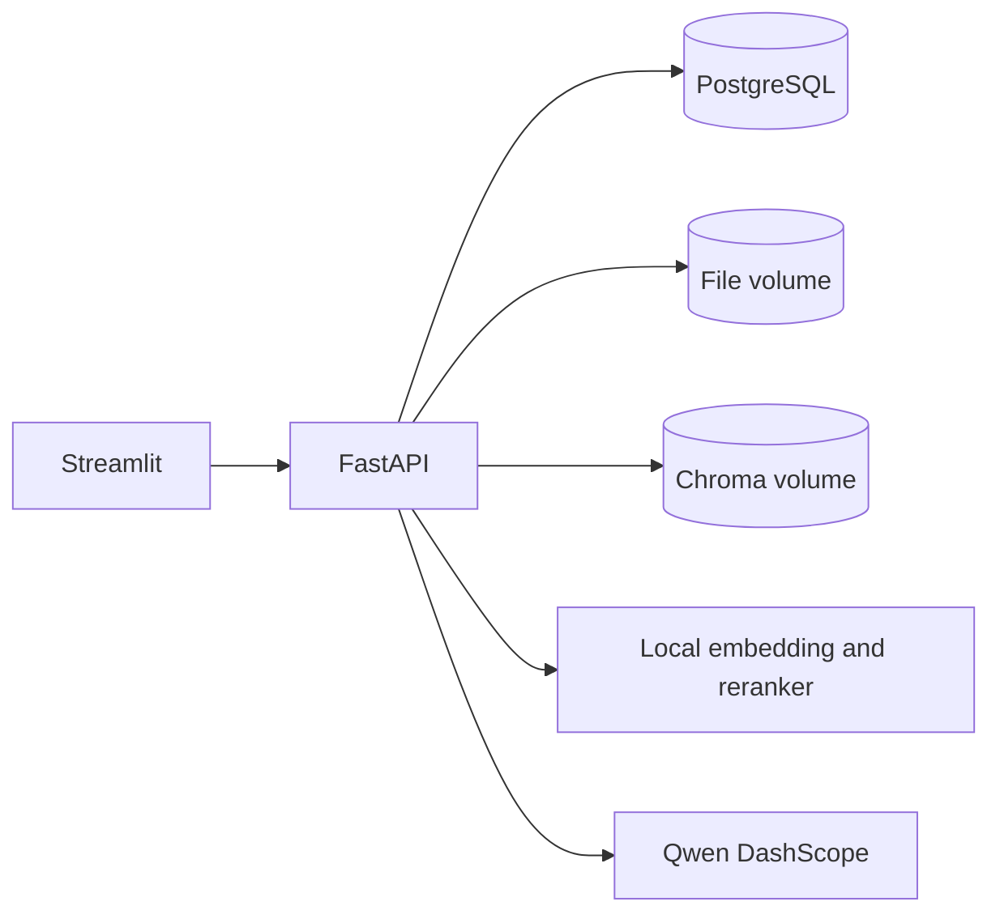

# Private RAG Multi-Document Assistant

A local document question answering application with account based isolation. Users upload PDF, DOCX, TXT or CSV files, search their own indexed chunks, and chat with Qwen using cited excerpts. Streamlit talks exclusively to FastAPI. PostgreSQL stores identities, document metadata and conversations; Chroma stores embeddings.

## Problem and features

The earlier single-user prototype accepted a typed username as identity and shared one vector index. This version introduces authenticated accounts, per-user SQL and vector access, persistent chats, safe uploads, optional document filtering, CrossEncoder reranking, streaming answers and structured source previews. A retrieval-only endpoint supports reproducible quality checks without using a paid LLM.

## Architecture



Upload: bounded file read → format validation → text extraction → chunks of up to 1000 characters with 200 overlap → MiniLM embeddings → Chroma vectors tagged with server assigned owner and document IDs. Query: authenticate → verify requested document IDs → owner filtered semantic search → optional CrossEncoder rerank → Qwen answer → source metadata. Empty search results do not call the LLM. Retrieved excerpts are marked as untrusted data in the prompt.

## Quick start

Python 3.12 and Docker Desktop with a running Linux engine are required. The first upload downloads the embedding model; reranking downloads a second model. Qwen answers need a DashScope API key, while upload and retrieval do not.

1. Copy `.env.example` to `.env`.
2. Replace `POSTGRES_PASSWORD` with a unique long alphanumeric value and `JWT_SECRET` with a random secret of at least 32 bytes. Set `QWEN_API_KEY` if generated answers are needed.
3. Run `docker compose up --build`. The backend applies Alembic migrations on startup.
4. Open [Streamlit](http://localhost:8501) and [FastAPI docs](http://localhost:8000/docs). Ports bind to localhost.

For a manual migration run `docker compose exec backend alembic upgrade head`. For tests run `python -m pip install -r backend/requirements-dev.txt`, then `PYTHONPATH=backend python -m pytest backend/tests -q` on Linux/macOS or `$env:PYTHONPATH='backend'; python -m pytest backend/tests -q` in PowerShell. Run `python -m ruff check backend frontend evaluation` for linting. For local development, set `DATABASE_URL`, `JWT_SECRET` and `DATA_DIR`; from `backend/` run `alembic upgrade head` and `uvicorn app.main:app --reload`; from `frontend/` run `streamlit run app.py` with `API_URL=http://localhost:8000`.

## API example

```bash
curl -X POST http://localhost:8000/auth/register -H 'Content-Type: application/json' -d '{"username":"alice","email":"alice@example.com","password":"choose-a-long-password"}'
curl -X POST http://localhost:8000/auth/login -H 'Content-Type: application/json' -d '{"email":"alice@example.com","password":"choose-a-long-password"}'
curl -X POST http://localhost:8000/documents -H "Authorization: Bearer $TOKEN" -F 'file=@notes.txt'
curl -X POST http://localhost:8000/rag/query -H "Authorization: Bearer $TOKEN" -H 'Content-Type: application/json' -d '{"question":"What is in my document?"}'
```

`/rag/query/stream` emits `sources`, `token`, `done` and `error` Server-Sent Events. Other routes: `/auth/me`, `/documents`, `/documents/{id}`, `/chats`, `/chats/{id}`, `/chats/{id}/messages`, `/rag/search`, `/health/live`, `/health/ready`. Private endpoints use bearer tokens.

## Repository

- `backend/app`: API, SQLAlchemy entities, authentication, retrieval and LLM transport.
- `backend/alembic`: database schema migration.
- `backend/tests`: API, isolation and vector filtering tests.
- `frontend`: Streamlit HTTP client.
- `evaluation`: synthetic data and retrieval measurement script.
- `rag_app`: original prototype, retained for reference. Do not run it with private multi-user data.

## Evaluation

After starting services and downloading models, run `python evaluation/evaluate.py`. It creates a temporary account, indexes a synthetic sample, compares dense search with and without reranking, deletes its document, and writes measured Hit@3, MRR, server retrieval latency and total HTTP latency to `evaluation/results/latest.json`. The two-question sample is a smoke benchmark, not a representative quality score. No results are claimed until the script is run. End-to-end answer latency is not measured by this script. Details are in [evaluation methodology](docs/evaluation.md).

## Security and limitations

Passwords use salted scrypt; tokens are HMAC SHA256 signed with expiration. SQL queries, document lists, chat reads and vector searches scope by the authenticated user. Uploads have a 10 MiB cap, generated storage names and validation. API keys come from environment variables. Keep the app local until security and deployment checks pass in the target environment.

Uploads and embedding calls are synchronous per request after bounded file reads, so large documents can occupy a worker. Chroma and PostgreSQL are separate stores without distributed transactions. A failed indexing or deletion operation can require cleanup. Streamed answers are saved only after completion; disconnects do not save partial messages. No rate limiting, malware scanning or OCR is included. Prompt injection defenses cannot guarantee LLM behavior. Source previews expose document text to its owner.

The original Git history already contains `rag_app/chats.json` and `rag_app/data/data.pdf`. This implementation does not read or migrate their contents. Ignore rules do not erase history; assess sensitivity and rotate exposed secrets before public release. See [security notes](docs/security.md).

## Roadmap

Add durable background ingestion when concurrent uploads justify it, reverse proxy upload and request rate limits, a larger public evaluation set, and optional hybrid retrieval after measured improvement.
